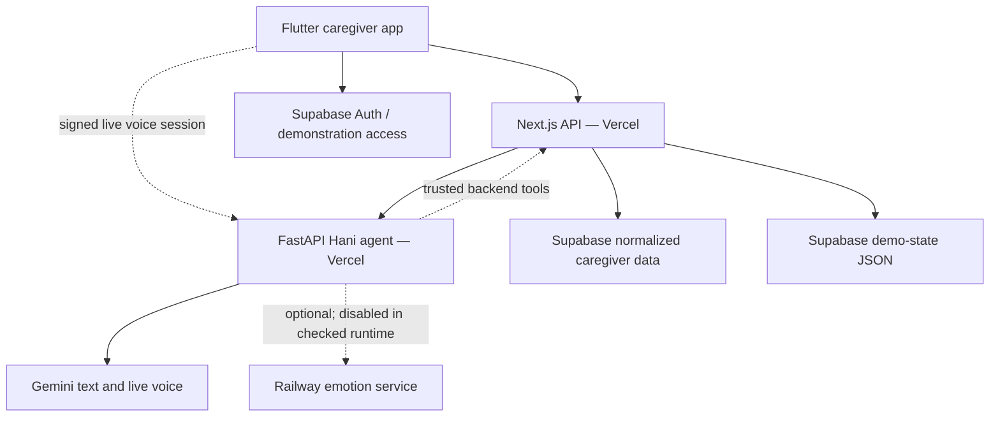

# Hani Maak — Current Architecture
**Verified baseline:** 20 October 2026. Read-only inspection of GitHub, Vercel, Supabase and Railway. Not a production-readiness or clinical-safety certification.

## Components

## Verification
- Vercel main production web deployment reported READY; Hani agent health reported caregiver-ready.
- Deployed agent reported text model gemini-3.8-flash and live model gemini-3.8-live, both configurable; emotion analysis disabled.
- Railway emotion-service-v2 was online independently; older emotion-service was offline.
- Supabase project healthy, storing both normalized caregiver records and a legacy demo-state singleton. Runtime system status reported Supabase-backed persistent writes.
- Database held 32 chat and 55 voice conversation records, and 385 Hani messages when checked. Those counts do not prove complete transcript or raw-audio retention.
- Real Supabase authentication and a separate demonstration shortcut coexist; do not confuse the demo shortcut with production authentication.

## Open checks
1. Route-to-table ownership and legacy demo-state dependencies.
2. Exact voice transcript persistence and retention rules.
3. Real-user authorization and service-role access boundaries.
4. End-to-end browser/mobile workflow testing.
5. Feature maturity: implemented code versus working production flow.
6. Repo schema and running database migration history reconciliation.

No FHIR/openEHR, live hospital EHR integration or independently approved clinical content has been verified.