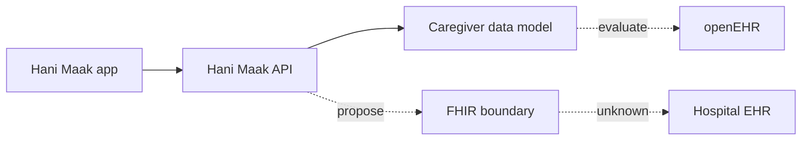
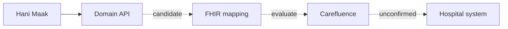

# Hani Maak — Integrated Action Plan

**Version:** 0.1 | **Updated:** 20 October 2026
**Prepared for review by:** Lloyd Williams and Aditya Ayyagari
**Coordinator:** Adam Ben Arbia

## Purpose

Coordinate clinical-data/openEHR, FHIR implementation, product engineering, hospital discovery and potential research. Hani Maak is a caregiver-first Alzheimer companion; hospital integration and clinical approval remain unconfirmed.

## Workstream owners

| Workstream | Owners | Output |
|---|---|---|
| Coordination and architecture | Adam | Integrated plan and technical baseline |
| Clinical data/openEHR | Salma and Hela, with Eya review | Domain inventory and archetype assessment |
| FHIR implementation | Ahmed (proposed), Adam, Emna (proposed) | Prioritized use cases and mapping |
| Product engineering | Adam and Ahmed, with Emna | Schema reconciliation and QA |
| Hospital communication | Salma and Hela | Razi discovery; no confirmed pilot |
| Research | Salma and Adam | Literature review and candidate research questions |

## Next phases

**Week 1:** verify current architecture, running schema, clinical-validation evidence, use cases and repository QA.

**Weeks 2–3:** explore existing openEHR models, minimal data set, FHIR mapping, privacy and provenance boundaries and research gaps.

**Advisor review:** decide priorities, FHIR version and profiles, clinical review expectations and first synthetic proof-of-concept scope.

**Later:** consider a read-oriented interoperability proof of concept after technical and clinical review.

See linked architecture, schema, clinical-validation and use-case documents for details.

## Proposed architectural directions

Current Hani Maak systems remain separate from hospital information systems. openEHR modeling and FHIR exchange are options for technical review, not implemented functionality.

**Possible Carefluence-based evaluation path (illustrative only):**

These diagrams do not establish a technical agreement or hospital pilot.
